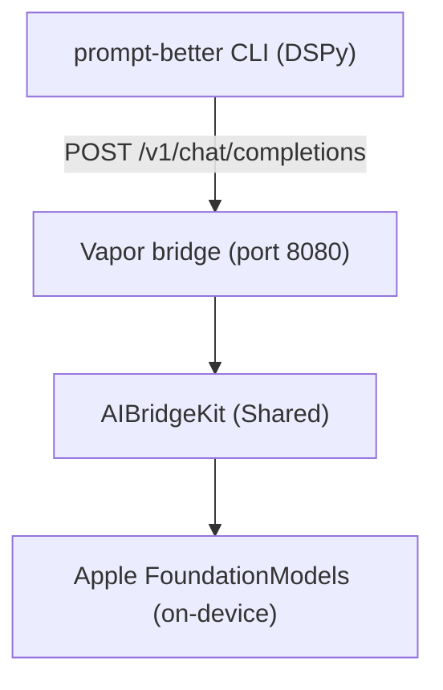

# AI Bridges (`AIBridges`)

`AIBridges` contains minimal Vapor-based bridge servers that expose Apple's on-device LLM (the `FoundationModels` framework, also known as Apple Intelligence) as an OpenAI-compatible REST API, so the `prompt-better` optimizer can run prompts on target Apple hardware over HTTP.

They implement only what optimization needs: text chat completions and model listing.



| Path | Contents |
| :--- | :--- |
| [Shared](Shared) | `AIBridgeKit`: OpenAI DTOs, model IDs, the FoundationModels runner, routes and error middleware |
| [macOS](macOS) | Headless command-line server (macOS 26+) |
| [iOS](iOS) | SwiftUI app with start/stop, the local address and a request log (iOS 26+) |

## API

| Route | Purpose |
| :--- | :--- |
| `POST /v1/chat/completions` | Text chat completion (`model`, `messages`, `temperature`, `top_p`, `max_tokens`) |
| `GET /v1/models` | `default`, `apple-foundation-model-3-core-3b`, `apple-foundation-model`, `apple-intelligence-private-cloud-compute` |
| `GET /health` | `Bridge is running on port 8080` (`iOS Bridge ...` on iOS) |

Request:

```json
{
  "model": "apple-foundation-model-3-core-3b",
  "messages": [
    {"role": "system", "content": "Answer briefly."},
    {"role": "user", "content": "Summarize the key benefits of on-device LLMs."}
  ],
  "temperature": 0.0,
  "max_tokens": 128
}
```

Response:

```json
{
  "id": "chatcmpl-D09D5B48-A971-4DF0-97DF-D9EA19CA8208",
  "object": "chat.completion",
  "created": 1717491600,
  "model": "apple-foundation-model-3-core-3b",
  "choices": [
    {
      "index": 0,
      "message": {"role": "assistant", "content": "Lower latency, privacy, offline use, and no API costs."},
      "finish_reason": "stop"
    }
  ],
  "usage": {"prompt_tokens": 0, "completion_tokens": 0, "total_tokens": 0}
}
```

`LanguageModelSession` does not report token usage, so `usage` is always `0`. How requests map onto the session is described in [docs/APPLE_BRIDGES.md](../docs/APPLE_BRIDGES.md#how-requests-are-run).

## Running

### macOS

```bash
cd AIBridges/macOS
swift build -c release
swift run App serve --hostname 127.0.0.1 --port 8080
```

Tests: `swift test` in `AIBridges/macOS` (server, including a live completion that needs Apple Intelligence) and `AIBridges/Shared` (request mapping).

### iOS

```bash
cd AIBridges/iOS
xcodegen generate
open iosAIBridge.xcodeproj
```

Run the `iosAIBridge` scheme on an iOS 26+ device or simulator. The server starts on launch and binds to the WiFi interface; the dashboard shows the `base_url` to use and logs each request.

## Configuring `prompt-better`

```json
{
  "student": {
    "base_url": "http://127.0.0.1:8080/v1",
    "model": "apple-foundation-model-3-core-3b"
  }
}
```

Or via environment variables:

```bash
export PROMPT_BETTER_STUDENT_BASE_URL="http://127.0.0.1:8080/v1"
export PROMPT_BETTER_STUDENT_MODEL="apple-foundation-model-3-core-3b"
```

> [!TIP]
> For a physical iOS device, set `base_url` to the address shown in the app (e.g. `http://192.168.1.45:8080/v1`). The Mac and the device must be on the same network.
