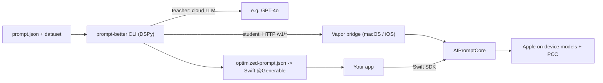

# JSON-Driven Prompt Optimization Framework based on DSPy

[](https://pypi.org/project/prompt-better/)
[](https://opensource.org/licenses/MIT)
[](https://pypi.org/project/prompt-better/)

**_ANYTHING YOU CAN PROMPT, I CAN PROMPT BETTER!_**


---

## 1. What This Is About

`prompt-better` is a generic, reusable, and platform-agnostic framework designed to evaluate, execute, and optimize Large Language Model (LLM) prompts. Instead of hardcoding prompts inside application source files, prompts are defined in a language-agnostic data asset (`prompt.json`), establishing a **Single Source of Truth (SSOT)**.

### Built on Top of DSPy & Pydantic

At runtime, `prompt-better` parses the JSON specification and builds type-safe Pydantic models on-the-fly. It automatically generates a corresponding **DSPy Signature** (`Inputs -> PydanticSchemaClass`), mapping unstructured model outputs into strictly validated objects.

### Coached Student-Teacher Model Paradigm

To support resource-constrained target devices (like local 3B–8B weights), the framework uses a **Coached Student-Teacher Pipeline**:

- **Teacher Model**: A high-capacity cloud model (e.g., GPT-4o) that drafts prompt/instruction variations, synthesizes few-shot demonstrations, and evaluates execution quality against custom rubrics.
- **Student Model**: The target local or on-device model being optimized. The student executes prompt candidates during the compilation loop.


### iOS and macOS On-Device Foundation Models

`prompt-better` integrates natively with Apple's on-device **FoundationModels** (iOS 26+ / macOS 26+). Apple's capabilities are exposed under canonical model IDs through two paths that share one engine:

- **Swift SDK**: `AppleOpenAIClient` from [AIPromptCore](frameworks/AIPromptCore), in-process and typed.
- **OpenAI-compatible HTTP**: [macOS and iOS Vapor bridges](AIBridges) that the Python optimizer uses as the student endpoint.

Covered models: on-device language models and Private Cloud Compute, multimodal chat with RAG, Vision OCR, PDF extraction, translation, speech-to-text and text-to-speech, sentence/word/image embeddings, hybrid local search, and image generation. See the [Apple model catalog](docs/APPLE_MODELS.md).



---

## 2. Short Example for Optimize

Follow these steps to optimize instructions for the sample `TopicClassifierPrompt`. A concrete reference implementation can be found in the [example/](example/) folder, which contains the [TopicClassifier](example/prompts/TopicClassifier) example prompt specification, its dataset, and automated scripts.

### Step 1: Set Up Python Environment

Install `prompt-better` in editable mode using `uv` and trust python runtimes configured in `mise.toml`:

```bash
# Trust and install local python versions
mise trust && mise install

# Install prompt-better locally
mise exec -- uv pip install -e .
```

### Step 2: Start Student Vapor Bridge (Example: macOS Bridge)

Build and run the Apple Silicon bridge server (translates on-device models to `/v1/chat/completions` endpoints):

```bash
cd AIBridges/macOS
swift build && swift run App serve --hostname 127.0.0.1 --port 8080
```

### Step 3: Setup Configuration & Credentials

The framework resolves configurations hierarchically: CLI arguments > Environment variables > Configuration files (`prompt-better.json`).

1. **Configuration File (`prompt-better.json`)**:
   Create a `prompt-better.json` file in the parent folder of your prompts directory (for this example, `example/prompt-better.json`). This defines student/teacher runtimes and defaults:

   ```json
   {
     "student": {
       "base_url": "http://127.0.0.1:8080/v1",
       "model": "apple-foundation-model-3-core-3b",
       "temperature": 0.2
     },
     "teacher": {
       "base_url": "https://api.openai.com/v1",
       "model": "gpt-4o",
       "temperature": 0.2,
       "eval_temperature": 0.0
     },
     "auto_mode": "light",
     "num_threads": 1
   }
   ```

2. **Credentials (API Keys)**:

   > [!IMPORTANT]
   > For security, API keys **cannot** be stored in the `prompt-better.json` configuration file. Doing so will trigger a validation error.

   Provide API keys using either environment variables or direct CLI arguments:
   - **Via Environment Variables** (Recommended):
     ```bash
     export PROMPT_BETTER_TEACHER_API_KEY="sk-proj-..."
     ```
   - **Via CLI Flags**:
     Pass `--teacher-api-key "sk-proj-..."` directly during command execution.

### Step 4: Run DSPy Optimization

Run the `optimize` command. Pass `--no-requires-permission-to-run` to bypass estimated token cost warnings when targeting free local endpoints:

```bash
python3 -m prompt_better.cli optimize \
  --prompts-dir example/prompts \
  --prompt TopicClassifierPrompt \
  --no-requires-permission-to-run
```

During execution, the DSPy `MIPROv2` compiler will propose instruction re-writes via the Teacher model, run them on the Student bridge, and evaluate output quality.

The optimization output is written to:

- `results/optimized-prompt.json`: Optimized prompt with winning instructions.
- `results/optimize-report.json`: Metrics report and validation summary.
- `results/dspy.json`: Serialized DSPy compile state.

---

## 3. Documentation

| Topic | Doc |
| :--- | :--- |
| Apple models: full catalog, Swift SDK and OpenAI API usage, aliases | [docs/APPLE_MODELS.md](docs/APPLE_MODELS.md) |
| Bridges and AIPromptCore setup (macOS, iOS, XCFramework, codegen) | [docs/APPLE_BRIDGES.md](docs/APPLE_BRIDGES.md) |
| `evaluate`: scoring formulas, custom evaluators, flow | [docs/EVALUATE.md](docs/EVALUATE.md) |
| `optimize`: workflow, optimizers (`predict`, MIPROv2, GEPA), iOS guidance | [docs/OPTIMIZE.md](docs/OPTIMIZE.md) |
| JSON specs: `prompt.json`, dataset cases, golden truth | [docs/SCHEMAS.md](docs/SCHEMAS.md) |
| CLI commands, environment variables, presets, Gradle, books | [docs/REFERENCE.md](docs/REFERENCE.md) |
| Bridge HTTP endpoints and device testing | [AIBridges/README.md](AIBridges/README.md) |
| AIPromptCore API, RAG, Generable prompts | [frameworks/AIPromptCore/docs](frameworks/AIPromptCore/docs) |
| Gradle plugin | [contrib/gradle](contrib/gradle/README.md) |

## 4. Commands at a Glance

| Command | Purpose |
| :--- | :--- |
| `list-prompts`, `preview-schema`, `evaluate-spec` | Discover and validate prompt specs |
| `evaluate` | Score the current prompt against the student (and optional teacher) |
| `optimize` | Compile better instructions and few-shot examples with DSPy |
| `generate-golden-truth` | Draft golden-truth files with the teacher |
| `generate` | Emit Swift `@Generable` structs for `AIPromptCore` |

Details: [docs/REFERENCE.md](docs/REFERENCE.md).
