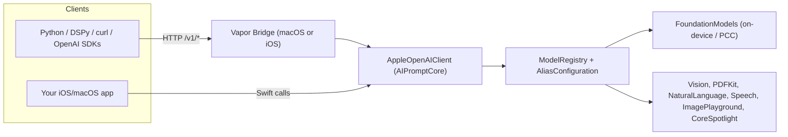

# Apple Models: Catalog & Integration

> Part of the [prompt-better docs](../README.md).

Every Apple on-device capability is exposed under a **canonical model ID** (`CanonicalModel` in [ModelRegistry.swift](../frameworks/AIPromptCore/Sources/AIPromptCore/Registry/ModelRegistry.swift)). The same ID works through two integration paths:

| Path | How | Use it when |
| :--- | :--- | :--- |
| **Swift SDK** | `AppleOpenAIClient.shared` from [AIPromptCore](../frameworks/AIPromptCore), in-process, no HTTP | You are building an iOS/macOS app and want zero network overhead and typed Swift APIs. |
| **OpenAI-compatible HTTP** | Vapor [bridges](APPLE_BRIDGES.md) (`/v1/...` routes) | You call from Python (`prompt-better`, DSPy), curl, or any OpenAI client, including from a Mac to a physical iPhone. |

Both paths share one engine, so a model behaves the same either way.



---

## 1. Model Catalog

### Model types

Models are classified with standard terms, not product names. `GET /v1/models` returns each model's `type` and `input_modalities` (extensions to the OpenAI schema), and `CanonicalModel.type` / `.inputModalities` expose them in Swift. Chat UIs use them to offer only the inputs a model accepts.

| `type` | Meaning | Inputs (`input_modalities`) | Models |
| :--- | :--- | :--- | :--- |
| `llm` | Text-only language model | `text` | `apple-intelligence-private-cloud-compute`; `default` and its two aliases on the 3B tier |
| `vlm` | Vision-language model: takes images together with text, natively | `text`, `image` | `default` and its two aliases on the advanced tier (see below) |
| `multimodal` | Language model behind a perception pipeline, with optional local RAG | `text`, `image`, `audio`, `document` | `omni` |
| `ocr` | Image to text | `image` | `apple-vision-ocr` |
| `document` | Document text extraction | `document` (PDF) | `apple-pdf-extractor` |
| `translation` | Machine translation | `text` | `apple-translation` |
| `nlp` | Tagging and entity recognition | `text` | `apple-nl-tagger` |
| `stt` | Speech to text / speech to English | `audio` | `apple-speech-transcribe`, `apple-speech-translate` |
| `tts` | Text to speech | `text` | `apple-speech-synthesize` |
| `embedding` | Vector embeddings | `text` (`image` for feature print) | `apple-sentence-embedding`, `apple-word-embedding`, `apple-vision-featureprint` |
| `moderation` | Content moderation | `image` | `apple-sensitive-content` |
| `search` | Retrieval over the local index | `text` | `apple-local-search` |
| `image-generation` | Image generation | `text` | `apple-image-playground` |

`image` inputs also cover videos in chat UIs, which sample frames from the video.

**The type of `default` depends on the device.** `default`, `apple-foundation-model-3-core-3b` and `apple-foundation-model` all run `SystemLanguageModel.default`, so `/v1/models` reports them as `vlm` (text + image) when the active [tier](#which-model-is-default) is `core-advanced` and as `llm` (text only) otherwise. Images sent to them are passed to the model itself (OS 27+), not OCR'd.

> [!WARNING]
> Image input is **verified** for the advanced tier (it described a generated image correctly in the test suite) and **assumed unsupported** for the 3B tier. The SDK has no capability flag, and no 3B device was available to test. If the 3B model turns out to accept images, change `AFMTier.acceptsImages`.

**`omni` and images:** on a `vlm` tier, `omni` passes images to the language model as images, so it can describe a photo or answer questions about it. When the tier does not accept images (3B, or OS 26) it falls back to OCR, which only recovers printed text, and the prompt then contains the text with an `[Attached Image OCR Extracted Text]` marker, or a note that no text was found. Documents and audio are always extracted to text first.

### Language models (raw AFM: no perception, no RAG)

| Model ID | What it is | SDK | HTTP |
| :--- | :--- | :--- | :--- |
| `default` | `SystemLanguageModel.default`, the system's current on-device model (on OS 27+ this is the `core3` or `coreAdvanced3` variant) | `client.chat.completions` | `POST /v1/chat/completions` |
| `apple-foundation-model-3-core-3b` | The on-device 3B model | `client.chat.completions` | `POST /v1/chat/completions` |
| `apple-foundation-model` | Generic alias for the on-device model | `client.chat.completions` | `POST /v1/chat/completions` |
| `apple-intelligence-private-cloud-compute` | Private Cloud Compute (PCC) | `client.chat.completions` | `POST /v1/chat/completions` |

> [!NOTE]
> `apple-foundation-model-3-core-advanced-20b-sparse` (OS 27+, at least 12 GB RAM) is not a separate ID. It is what `default` resolves to on capable hardware. See [Which model is `default`?](#which-model-is-default).

> [!NOTE]
> Raw language models reject media they cannot process natively: a chat request with audio or document parts (or image parts, for `llm` models) returns HTTP 400 (`unsupported_operation`) in the HTTP API, and throws `AIError.unsupportedOperation` in the SDK. Use `omni` or a direct model. `vlm` models accept images.

### Multimodal & RAG

| Model ID | What it does | SDK | HTTP |
| :--- | :--- | :--- | :--- |
| `omni` | Chat with a perception pre-pass (images as images, or OCR on tiers that cannot see them; PDF text; audio transcription) and optional Auto-RAG, then the on-device LLM | `chat.completions.create(... rag:)` | `POST /v1/chat/completions` (content parts + `rag` object) |

### Standalone direct models (bypass the LLM)

| Model ID | Backing framework | SDK | HTTP |
| :--- | :--- | :--- | :--- |
| `apple-vision-ocr` | Vision text recognition. Send an `image_url` part, get the text back | `chat.completions` | `POST /v1/chat/completions` |
| `apple-pdf-extractor` | PDFKit. Send a base64 `document` part with format `pdf` | `chat.completions` | `POST /v1/chat/completions` |
| `apple-translation` | Apple Translation framework. Auto-detects the source language and translates the prompt to English. Needs the language packs installed | `chat.completions` | `POST /v1/chat/completions` |
| `apple-nl-tagger` | NaturalLanguage tagger. Returns JSON with detected language, named entities and lexical-class tokens | `chat.completions` | `POST /v1/chat/completions` |

### Audio

| Model ID | What it does | SDK | HTTP |
| :--- | :--- | :--- | :--- |
| `apple-speech-transcribe` | Speech-to-text. Needs a build with the speech flag | `client.audio.transcriptions.create` | `POST /v1/audio/transcriptions` |
| `apple-speech-synthesize` | Text-to-speech, returns 16-bit PCM WAV | `client.audio.speech.create` | `POST /v1/audio/speech` |
| `apple-speech-translate` | Spoken audio to English text. Composes `apple-speech-transcribe` with on-device translation, so it needs the speech build flag and installed language packs | `client.audio.translations.create` | `POST /v1/audio/translations` (like OpenAI's endpoint) |

### Embeddings

| Model ID | Output | SDK | HTTP |
| :--- | :--- | :--- | :--- |
| `apple-sentence-embedding` | 512-dim sentence vectors (NaturalLanguage) | `client.embeddings.create` | `POST /v1/embeddings` |
| `apple-word-embedding` | Word vectors (NaturalLanguage) | `client.embeddings.create` | `POST /v1/embeddings` |
| `apple-vision-featureprint` | Image feature-print vectors (Vision). Input is a data URL | `client.embeddings.create` | `POST /v1/embeddings` |

### Search

| Model ID | What it does | SDK | HTTP |
| :--- | :--- | :--- | :--- |
| `apple-local-search` | Hybrid retrieval (CoreSpotlight + vector, fused by RRF or linear weights) | `client.index.add` / `client.index.search` | `POST /v1/index/documents`, `POST /v1/search` |

### Moderation

| Model ID | What it does | SDK | HTTP |
| :--- | :--- | :--- | :--- |
| `apple-sensitive-content` | Image moderation via SensitiveContentAnalysis. Reports one category, `sexual` (nudity), as a boolean with score `1.0` or `0.0`. **Text input is rejected** (HTTP 400) | `client.moderations.create(images:)` | `POST /v1/moderations` with `image_url` parts |

### Image generation

| Model ID | What it does | SDK | HTTP |
| :--- | :--- | :--- | :--- |
| `apple-image-playground` | Image Playground sheet over the frontmost window; the user picks the image (fails with 503 when no window is available) | `client.images.generate` / `generatePlayground` | `POST /v1/images/generations` |

### Which model is `default`?

`default`, `apple-foundation-model-3-core-3b` and `apple-foundation-model` all run `SystemLanguageModel.default`, so the system decides which tier answers. AIPromptCore reports it as `AFMTier` (`ModelRegistry.activeTier`, `AFMTier.detect()`):

| Tier | Meaning |
| :--- | :--- |
| `core-3b` | 3B dense model |
| `core-advanced` | 20B sparse (MoE) model |
| `unavailable` | Apple Intelligence not available (ineligible device, disabled, model not ready) |

How it is detected, in order:

1. **Availability first**: if `SystemLanguageModel.default.availability` is not `.available`, the tier is `unavailable`.
2. **OS 27+**: use `SystemLanguageModel.default.variant` (`coreAdvanced3` or `core3`). This is what the system actually reports, so it is authoritative (source `systemVariant`).
3. **OS 27+, unrecognized variant** (a future model): fall back to physical memory, at least 12 GB means `core-advanced`, otherwise `core-3b` (source `inferred`).
4. **OS 26**: only the 3B model ships and there is no variant API, so the tier is `core-3b` (source `inferred`).

Why not use RAM alone: memory says what a device could run, not what the system selected. A 16 GB device on OS 26 still runs the 3B model. So the variant API decides when it exists, and memory only breaks ties for variants we do not know yet. The `inferred` source in the diagnostics line (`tier: core-3b (inferred)`) tells you when the answer is a guess.

The tier appears in the startup diagnostics of both bridges (`tier: core-3b (systemVariant)`); the picker label for `default` shows the system's own variant name. To run a specific tier for optimization, check the diagnostics line for the tier your student actually uses: a student configured as `...-3b` is not pinned to the 3B model.

---

## 2. Using the Swift SDK

```swift
import AIPromptCore

let client = AppleOpenAIClient.shared   // @MainActor, in-process

// Chat (raw AFM)
let chat = try await client.chat.completions.create(
    model: "default",
    messages: [.init(role: "user", content: "Write a haiku about Swift.")],
    temperature: 0.2
)

// Typed structured output (@Generable)
let topic: TopicClassifierPrompt = try await client.chat.completions.create(
    model: "default",
    messages: [.init(role: "user", content: "Mars rover collects rock sample.")],
    generating: TopicClassifierPrompt.self
)

// Embeddings
let vec = try await client.embeddings.create(input: "on-device", model: "apple-sentence-embedding")

// Image moderation (images only; text throws)
let verdict = try await client.moderations.create(images: ["data:image/jpeg;base64,..."])
print(verdict.results[0].flagged)

// Index + hybrid search
await client.index.add(id: "doc-1", title: "Q3", content: "Revenue up 18%.", metadata: [:])
let hits = await client.index.search(query: "revenue", limit: 5, mode: .hybrid(k: 60.0))

// Images
let img = try await client.images.generatePlayground(prompt: "Neon street in rain", style: "illustration")
```

Sub-clients on `AppleOpenAIClient`: `chat`, `prompts`, `index`, `embeddings`, `audio`, `images`. Full examples, including multimodal chat, Auto-RAG, TTS/STT and image styles, are in the [API reference](../frameworks/AIPromptCore/docs/API_REFERENCE.md). Setup (SPM, XCFramework, speech flag, Info.plist keys) is in the [framework integration guide](../frameworks/AIPromptCore/docs/FRAMEWORK_INTEGRATION.md).

## 3. Using the OpenAI-compatible API

Start a bridge (see [Bridges](APPLE_BRIDGES.md)), then use any OpenAI client or curl against `http://127.0.0.1:8080/v1`.

```bash
# Chat
curl -s http://127.0.0.1:8080/v1/chat/completions -H 'Content-Type: application/json' -d '{
  "model": "apple-foundation-model-3-core-3b",
  "messages": [{"role": "user", "content": "Summarize on-device LLM benefits."}]
}'

# OCR via the direct vision model
curl -s http://127.0.0.1:8080/v1/chat/completions -H 'Content-Type: application/json' -d '{
  "model": "apple-vision-ocr",
  "messages": [{"role": "user", "content": [
    {"type": "image_url", "image_url": {"url": "data:image/png;base64,..."}}
  ]}]
}'

# Embeddings
curl -s http://127.0.0.1:8080/v1/embeddings -H 'Content-Type: application/json' \
  -d '{"model": "apple-sentence-embedding", "input": "hello"}'

# Image generation
curl -s http://127.0.0.1:8080/v1/images/generations -H 'Content-Type: application/json' \
  -d '{"model": "apple-image-playground", "prompt": "red panda with headphones", "response_format": "b64_json"}'

# Local RAG
curl -s http://127.0.0.1:8080/v1/search -H 'Content-Type: application/json' \
  -d '{"query": "software revenue", "mode": "hybrid", "limit": 5}'
```

| Method | Route | Models |
| :--- | :--- | :--- |
| `POST` | `/v1/chat/completions` | language, omni, vision-ocr, pdf-extractor, translation, nl-tagger |
| `POST` | `/v1/embeddings` | sentence, word, vision-featureprint |
| `POST` | `/v1/audio/transcriptions` | speech-transcribe (JSON or `multipart/form-data`) |
| `POST` | `/v1/audio/translations` | speech-translate (JSON or `multipart/form-data`; `language` = spoken language, output is English) |
| `POST` | `/v1/audio/speech` | speech-synthesize |
| `POST` | `/v1/moderations` | sensitive-content (images only) |
| `POST` | `/v1/images/generations` | image-playground |
| `POST` | `/v1/index/documents` | local-search (indexing) |
| `POST` | `/v1/search` | local-search (`vector`, `spotlight`, `hybrid`) |
| `GET` | `/v1/models` | lists canonical IDs, custom aliases, and OpenAI aliases if enabled |
| `GET` | `/health` | heartbeat |

Both bridges (macOS and iOS) register the same routes.

### Model aliases

`AliasConfiguration` lets existing OpenAI-targeted code run unchanged. Aliases resolve before lookup, and an `openai/` prefix is stripped.

| OpenAI name | Resolves to |
| :--- | :--- |
| `gpt-4o`, `gpt-4o-mini`, `gpt-4-turbo`, `gpt-4`, `gpt-3.5-turbo` | `omni` |
| `whisper-1`, `whisper` | `apple-speech-transcribe` |
| `tts-1`, `tts-1-hd` | `apple-speech-synthesize` |
| `text-embedding-3-small`, `text-embedding-3-large`, `text-embedding-ada-002` | `apple-sentence-embedding` |
| `omni-moderation-latest` | `apple-sensitive-content` |
| `dall-e-3`, `dall-e-2`, `dall-e` 
Enable them with `ENABLE_OPENAI_ALIASES=true` (or `AliasConfiguration.shared.enableOpenAIAliases = true`). Add your own with `MODEL_ALIASES='{"my-bot": "omni"}'` or `AliasConfiguration.shared.setAlias(alias:target:)`.

## 4. Implementation Status

- **Fail-loud routing**: chat completions only accept chat-capable models. Sending an embedding, audio, image or unimplemented ID to chat returns an `unsupportedOperation` error instead of silently reaching the language model.
- **Media is never dropped silently.** Unreadable images, invalid base64, non-PDF/non-UTF-8 documents, audio without a speech build, and direct models called without their media (`apple-vision-ocr` without an image, `apple-pdf-extractor` without a PDF) return `unsupported_operation`. Unknown content part types and malformed `content` fail request decoding. When processing succeeds but finds nothing (an image with no text, a scanned PDF, silent audio), the model receives an explicit note saying so.
- **Known gap: ignored request parameters.** Chat completions currently accept but ignore `stream`, `stop`, `response_format` and `n`; embeddings ignore `encoding_format` and `dimensions`; audio speech ignores `response_format` (always WAV).
- **`apple-sensitive-content`** moderates images only. Text input (a string, an array of strings, or `text` parts) returns HTTP 400 `unsupported_operation`; in the SDK it throws `AIError.unsupportedOperation`. It needs the `com.apple.developer.sensitivecontentanalysis.client` entitlement and the system Sensitive Content Warning (or Communication Safety) setting enabled. A plain `swift run` CLI has no entitlements, so expect an error there unless you sign the bridge with it; the iOS bridge app can carry the entitlement. The `text-moderation-*` OpenAI names are intentionally not aliased.
- **`apple-local-search`** works through `/v1/index/documents` and `/v1/search`, not as a chat `model`.
- **Speech**: `apple-speech-transcribe` and `apple-speech-translate` need a build with `ENABLE_SPEECH=1` or `--with-speech`. Otherwise their routes return `501`.
- **Translation** (`apple-translation`, `apple-speech-translate`) needs the source and target language packs installed (System Settings > General > Language & Region > Translation Languages). Missing packs return a descriptive error.

## 5. Using a model as the optimization student

Point the `student` block of `prompt-better.json` at a bridge and set `model` to a language-model ID (`default`, `apple-foundation-model-3-core-3b`, or `apple-intelligence-private-cloud-compute`). See [Configuration](REFERENCE.md#environment-variables).
