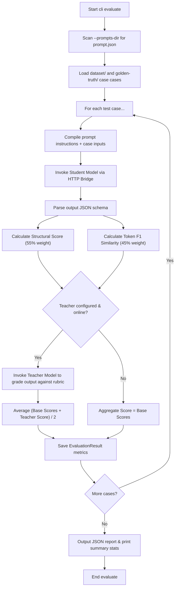

# Subcommand `evaluate`

> Part of the [prompt-better docs](../README.md).

The `evaluate` subcommand evaluates the **status quo** of your prompt's baseline instructions against a target dataset. It does not perform instruction rewriting or few-shot compilation. Instead, it measures how well the target Student model conforms to structure and accuracy guidelines under the current prompt instructions.

Running `evaluate` only requires the student model endpoint to be online. If the teacher model is configured and online, it is used to grade semantic quality and calculate an overall aggregate score. If the teacher model is offline or unconfigured, evaluation proceeds gracefully by ignoring the teacher grading and scoring based only on structural and similarity evaluations.

> [!TIP]
> For a deeper conceptual foundation on evaluating AI systems, we recommend referring to the book **"AI Engineering - Building Application with Foundation Models"** by **Chip Huyen** (O'Reilly), specifically **Chapter 4. Evaluate AI Systems**.

### Mathematical Scoring Formulas

For each evaluation case, the candidate output is rated between `0.0` and `1.0` using weighted scores.

If the Teacher Model is configured and online:
$$\text{Aggregate Score} = \frac{(0.55 \times S_{\text{structural}} + 0.45 \times S_{\text{similarity}}) + S_{\text{teacher}}}{2}$$

If the Teacher Model is unconfigured or offline during evaluation:
$$\text{Aggregate Score} = 0.55 \times S_{\text{structural}} + 0.45 \times S_{\text{similarity}}$$

### Scoring Metrics & Code References

The scores are resolved in code inside [evaluator.py](../prompt_better/dspy_manager/evaluator.py) via a resolved `Evaluator` instance (by default, `DefaultEvaluator` inherits from `BaseEvaluator`):

1.  **Evaluation Loop**: [evaluate_prompt](../prompt_better/dspy_manager/optimizer.py) iterates through prompt files and gathers results using `_evaluate_single_example`.
2.  **Structural Score ($S_{\text{structural}}$)**: Calculated in `structural_score`. It verifies:
    - Fields map precisely to target JSON schema types.
    - Array counts match specified boundaries (e.g. `min_count`, `max_count`).
3.  **Similarity Score ($S_{\text{similarity}}$)**: Calculated in `similarity_score`. It measures token-level F1 overlap (precision and recall of matching tokens) between the generated values and the golden-truth references.
4.  **Teacher Score ($S_{\text{teacher}}$)**: Resolved via `teacher_score`. If configured and online, the Teacher model receives a structured grading schema containing the prompt instructions, inputs, candidate output, reference output, and quality rubric. It responds with a numeric score (`0.0` to `1.0`) and a text justification. If unconfigured or offline, it is ignored (returns `None`).

### Custom Evaluator Implementations

You can customize the evaluation and scoring by providing your own evaluator subclassing `BaseEvaluator`:

```python
from prompt_better.dspy_manager import BaseEvaluator

class CustomEvaluator(BaseEvaluator):
    def structural_score(self, spec, candidate) -> float:
        # Custom structural scoring
        return 1.0

    def similarity_score(self, spec, reference, candidate) -> float:
        # Custom similarity scoring
        return 0.8
```

#### Setting the Custom Evaluator

You can configure the custom evaluator dynamically in three ways (resolved hierarchically):

1. **CLI Flag**: Specify `--evaluator path.to.module:CustomEvaluator` or file path `path/to/script.py:CustomEvaluator` (or simply `path/to/script.py` which auto-detects the subclass).
2. **Environment Variable**: `export PROMPT_BETTER_EVALUATOR="path.to.module:CustomEvaluator"`
3. **Global Config (`prompt-better.json`)**:
   ```json
   {
     "evaluator": "path.to.module:CustomEvaluator"
   }
   ```

### Evaluation Flow Diagram


