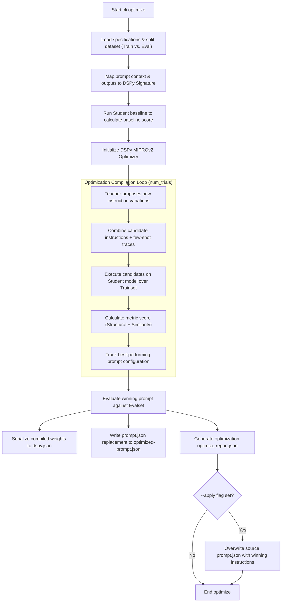

# Subcommand `optimize`

> Part of the [prompt-better docs](../README.md).

The `optimize` subcommand applies per default the DSPy **MIPROv2** (Multi-prompt Instruction Proposal and Few-shot Optimization) compiler to find the best instructions and few-shot examples for your target student model.

> [!TIP]
> For a deeper conceptual foundation on engineering and compiling prompts, we recommend referring to the book **"AI Engineering - Building Application with Foundation Models"** by **Chip Huyen** (O'Reilly), specifically **Chapter 5. Prompt Engineering**.

> [!NOTE]
> By default, the final evaluation at the end of optimization runs on **all dataset cases** to print a complete baseline vs optimized comparison table. To run the final evaluation only on the held-out evaluation set (`evalset`) slice, specify the `--eval-cases-only` flag.

> [!IMPORTANT]
> **iOS & On-Device Model Recommendation**: If you compile your prompt specification to a Swift type conformant to `GenerableWithPrompt` (which utilizes Apple's native schema-guided structured output), you have two options for handling optimization:
>
> - **Option 1: Direct Prediction (Recommended for speed/simplicity)**: Optimize your prompt using `--optimizer predict` (or set `"optimizer": "predict"` in `prompt-better.json`). This compiles the prompt using `dspy.Predict` instead of the default `dspy.ChainOfThought` (which uses `"chain-of-thought"`). Because the default CoT generates formatting instructions instructing the model to output intermediate reasoning with text prefixes (e.g. `Reasoning:` and `Output:`), it conflicts with Apple's native structured JSON schema constraint (where no `reasoning` field exists), leading to parsing or validation errors. Running with `predict` compiles cleanly without these text prefixes.
> - **Option 2: Schema-guided Chain of Thought (Recommended for accuracy)**: If the target model needs step-by-step reasoning to deliver accurate outputs, you must explicitly model the reasoning field inside your `prompt.json` output schema:
>
>   ```json
>   "outputs": [
>     {
>       "name": "reasoning",
>       "type": "string",
>       "desc": "Explanation of the context based on domain-specific lexical cues."
>     },
>     {
>       "name": "topic",
>       "type": "string",
>       "desc": "The final classified topic category."
>     }
>   ]
>   ```
>
>   When compiled, the generated Swift struct will contain both fields as `@Guide` properties:
>
>   ```swift
>   @Generable
>   struct TopicClassifierPrompt: GenerableWithPrompt {
>       @Guide(description: "Explanation of the context...")
>       var reasoning: String
>
>       @Guide(description: "The final classified topic category.")
>       var topic: String
>   }
>   ```
>
>   This aligns the prompt's reasoning instructions with the Swift schema structure, allowing Apple's native session to parse the intermediate reasoning step successfully.

### Optimization Workflow

1.  **Splitting Dataset**: The command loads optimization cases and splits them into training and evaluation sets based on `--train-ratio` (default `0.8`).
2.  **Generating Candidates (Teacher)**: The high-capacity Teacher model reads the baseline specifications, analyzes errors from initial runs, and generates instruction proposals (candidates).
3.  **Compiling Few-Shot Demonstrations**: DSPy selects successful execution traces from the student model running on the training dataset to include as few-shot bootstrap examples in the compiled prompt.
4.  **Evaluation Iteration**: Candidate instruction proposals are evaluated against the training and validation sets on the student model.
5.  **Selecting the Winner**: The combination of instructions and few-shot demonstrations yielding the highest aggregate score is compiled and saved.

### Optimization Flow Diagram



### Built-in & Custom Optimizer Options

`prompt-better` supports several optimizer and compiler configurations:

| Optimizer Mode / Value | Description | iOS / On-Device Suitability |
| :--- | :--- | :--- |
| `"predict"` | Uses `dspy.Predict` with `MIPROv2` compiler. | **Best Suited for iOS**: Compiles prompt instructions without conversational chain-of-thought text headers (`Reasoning:`), conforming seamlessly to Apple's native schema-guided structured outputs. |
| `"chain-of-thought"` / `"miprov2"` (default) | Uses `dspy.ChainOfThought` with `MIPROv2` multi-prompt instruction & few-shot bootstrap proposal. | Great for general LLMs, but requires explicitly modeling a `reasoning` field in `outputs` if targeting Swift schema-guided sessions. |
| `"gepa"` | Uses DSPy v3's reflective optimizer (`dspy.GEPA` - Genetic Evolutionary Prompt Adaptation) via reflection LM. | Excellent for complex multi-objective tasks with detailed teacher evaluation rubrics. |
| Custom subclass of `BaseOptimizer` | Custom compile logic subclassing `BaseOptimizer`. | Flexible for specialized on-device fine-tuning or custom search strategies. |

#### Custom Optimizer Implementations

You can customize the optimization and compilation process by providing your own optimizer subclassing `BaseOptimizer`:

```python
from prompt_better.dspy_manager import BaseOptimizer

class CustomOptimizer(BaseOptimizer):
    def compile(
        self,
        config,
        spec,
        specs,
        student_lm,
        teacher_lm,
        trainset,
        evalset,
        metric,
        module,
    ):
        # Implement custom compilation or training loops
        ...
        return compiled_module
```

#### Setting the Optimizer

You can configure the optimizer dynamically in three ways (resolved hierarchically):

1. **CLI Flag**: Specify `--optimizer predict`, `--optimizer gepa`, or `--optimizer path.to.module:CustomOptimizer` / `path/to/script.py:CustomOptimizer` (or simply `path/to/script.py` which auto-detects the subclass).
2. **Environment Variable**: `export PROMPT_BETTER_OPTIMIZER="predict"` (or `"gepa"`, `"miprov2"`, custom class path).
3. **Global Config (`prompt-better.json`)**:
   ```json
   {
     "optimizer": "predict"
   }
   ```
